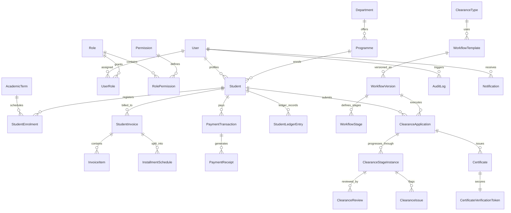

# Metropolitan University — Integrated Financial Management & Digital Clearance Portal
## Document: Relational Database Architecture & Schema Design
**Code:** `CPCS-MU-DOC-004`  
**Version:** 1.0.0  
**Database Engine:** PostgreSQL 16/18  
**ORM:** Prisma ORM  

---

### 1. Database Entity-Relationship Diagram (ERD)

---

### 2. Core Relational Schemas & Entities

#### A. Identity & Access Control
- **`users`**: `id` (UUID PK), `email` (unique), `password_hash`, `full_name`, `phone_number`, `is_active`, `created_at`, `updated_at`.
- **`roles`**: `id` (UUID PK), `name` (unique: `STUDENT`, `ACCOUNTS_OFFICER`, `LIBRARY_OFFICER`, `LAB_OFFICER`, `HALL_OFFICER`, `DEPT_HEAD`, `EXAM_CONTROLLER`, `SUPER_ADMIN`), `description`.
- **`permissions`**: `id` (UUID PK), `slug` (unique: e.g. `payment.verify`, `clearance.approve`, `certificate.issue`), `module`, `description`.
- **`user_roles`**: `user_id`, `role_id`, `assigned_at` (Composite PK).
- **`role_permissions`**: `role_id`, `permission_id` (Composite PK).

#### B. Academic & Student Information
- **`departments`**: `id` (UUID PK), `code` (e.g. `CSE`, `SWE`, `EEE`, `BBA`, `LAW`, `ENG`), `name`, `school_name`.
- **`programmes`**: `id` (UUID PK), `department_id` (FK), `code` (e.g. `BSC_CSE`), `title`, `degree_level` (`UNDERGRADUATE`, `GRADUATE`), `total_credits`.
- **`academic_terms`**: `id` (UUID PK), `code` (e.g. `SPRING_2026`, `SUMMER_2026`, `AUTUMN_2026`), `start_date`, `end_date`, `is_current`.
- **`students`**: `id` (UUID PK), `user_id` (FK, unique), `student_id` (e.g. `231-115-094`, unique), `programme_id` (FK), `batch_number`, `admission_term_id` (FK), `current_cgpa`, `guardian_phone`.

#### C. Financial Management & Double-Entry Ledger
- **`fee_categories`**: `id` (UUID PK), `code` (e.g. `TUITION`, `ADMISSION`, `TERM_REG`, `LAB_FEE`, `EXAM_FEE`, `CERTIFICATE_PPC`, `LIBRARY_FINE`), `name`, `is_recurring`, `is_active`.
- **`fee_structures`**: `id` (UUID PK), `programme_id` (FK), `fee_category_id` (FK), `amount_bdt`, `rate_per_credit`, `effective_term_id` (FK).
- **`student_invoices`**: `id` (UUID PK), `invoice_number` (unique), `student_id` (FK), `academic_term_id` (FK), `total_amount_bdt`, `waiver_amount_bdt`, `paid_amount_bdt`, `outstanding_balance_bdt`, `status` (`UNPAID`, `PARTIALLY_PAID`, `PAID`, `CANCELLED`).
- **`installment_schedules`**: `id` (UUID PK), `invoice_id` (FK), `installment_number` (1 to 4), `due_date`, `amount_bdt`, `late_penalty_bdt`, `status` (`PENDING`, `OVERDUE`, `PAID`).
- **`payment_transactions`**: `id` (UUID PK), `transaction_reference` (unique), `student_id` (FK), `payment_method` (`NRBC_BANK_DEPOSIT`, `BKASH_MFS`, `NAGAD_MFS`, `ONLINE_GATEWAY`), `amount_bdt`, `currency` (BDT), `bank_branch`, `slip_number`, `slip_document_url`, `gateway_transaction_id`, `status` (`INITIATED`, `PENDING_VERIFICATION`, `VERIFIED`, `REJECTED`, `FAILED`, `REFUNDED`), `verified_by_user_id` (FK), `verified_at`, `verification_remarks`.
- **`student_ledger_entries`**: `id` (UUID PK), `student_id` (FK), `entry_type` (`DEBIT_INVOICE`, `CREDIT_PAYMENT`, `CREDIT_WAIVER`, `DEBIT_PENALTY`), `amount_bdt`, `running_balance_bdt`, `reference_entity_type`, `reference_entity_id`, `created_at`.

#### D. Configurable Clearance Engine & Workflows
- **`clearance_types`**: `id` (UUID PK), `code` (e.g. `SEMESTER_FINAL`, `TRANSCRIPT`, `PPC`, `ORIGINAL_CERT`, `CONVOCATION`), `title`, `description`.
- **`workflow_templates`**: `id` (UUID PK), `clearance_type_id` (FK), `name`, `is_active`.
- **`workflow_versions`**: `id` (UUID PK), `template_id` (FK), `version_number`, `created_at`, `is_published`.
- **`workflow_stages`**: `id` (UUID PK), `workflow_version_id` (FK), `sequence_order` (int), `department_code` (`ACCOUNTS`, `LIBRARY`, `LABORATORY`, `HALL`, `DEPT_HEAD`, `EXAM_CONTROLLER`), `stage_name`, `is_conditional`, `condition_rules` (JSONB).
- **`clearance_applications`**: `id` (UUID PK), `application_number` (e.g. `MU-CLR-2026-0042`, unique), `student_id` (FK), `clearance_type_id` (FK), `workflow_version_id` (FK), `academic_session`, `status` (`SUBMITTED`, `IN_PROGRESS`, `FLAGGED`, `APPROVED`, `REJECTED`), `created_at`, `updated_at`.
- **`clearance_stage_instances`**: `id` (UUID PK), `application_id` (FK), `workflow_stage_id` (FK), `status` (`LOCKED`, `PENDING`, `APPROVED`, `FLAGGED`, `REJECTED`), `assigned_officer_id` (FK), `decided_at`.
- **`clearance_issues`**: `id` (UUID PK), `stage_instance_id` (FK), `flag_reason`, `dues_amount_bdt`, `is_resolved`, `resolved_at`, `officer_remarks`, `student_response`.

#### E. Certificates & Verification
- **`certificates`**: `id` (UUID PK), `certificate_number` (e.g. `MU-CERT-PPC-881923`, unique), `application_id` (FK, unique), `student_id` (FK), `issue_date`, `certificate_type`, `pdf_document_url`, `is_revoked`, `revocation_reason`, `revoked_at`.
- **`certificate_verification_tokens`**: `id` (UUID PK), `certificate_id` (FK, unique), `cryptographic_token` (SHA-256 hashed unique token), `public_lookup_code`, `created_at`.

#### F. Audit & Compliance
- **`audit_logs`**: `id` (UUID PK), `user_id` (FK, nullable), `action_tag` (e.g. `PAYMENT_VERIFIED`, `CLEARANCE_APPROVED`, `FEE_CONFIG_UPDATED`), `entity_type`, `entity_id`, `details` (JSONB), `ip_address`, `user_agent`, `created_at`.

