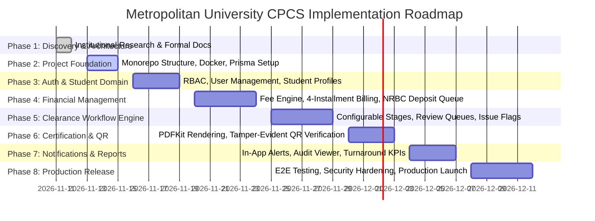

# Metropolitan University — Integrated Financial Management & Digital Clearance Portal
## Document: Phased Development Roadmap & Implementation Plan
**Code:** `CPCS-MU-DOC-009`  
**Version:** 1.0.0  

---

### 1. Phased Execution Roadmap

---

### 2. Phase Breakdown & Deliverables

#### Phase 1: Discovery, Architecture & Specifications (Complete)
- **Deliverables:** Approved documentation set (`docs/PROJECT_OVERVIEW.md`, `docs/REQUIREMENTS.md`, `docs/SYSTEM_ARCHITECTURE.md`, `docs/DATABASE_DESIGN.md`, `docs/USER_ROLES_AND_PERMISSIONS.md`, `docs/WORKFLOW_DESIGN.md`, `docs/API_SPECIFICATION.md`, `docs/SECURITY_PLAN.md`, `docs/DEVELOPMENT_ROADMAP.md`).
- **Success Criteria:** Architectural clarity aligning with official `metrouni.edu.bd` policies.

#### Phase 2: Foundation & Shared Infrastructure
- **Deliverables:** Modular codebase setup, PostgreSQL database with Prisma ORM, Docker containerization (`docker-compose.yml`), environment management, base UI design system tokens (Metropolitan University brand palette), logging, and global error boundaries.
- **Success Criteria:** Zero-friction local and Docker startup with verified database connectivity.

#### Phase 3: Authentication, RBAC & Student Profile Domain
- **Deliverables:** Centralized JWT authentication with refresh tokens, Argon2id/Bcrypt password hashing, 8 role guards, student academic profile management, and department/programme registries.
- **Success Criteria:** Multi-role login passing unit & integration security tests; unauthorized role access blocked.

#### Phase 4: Financial Management, Billing & Payment Processing
- **Deliverables:** Database-driven fee categories, 4-installment term billing engine, NRBC Bank deposit slip submission with receipt upload, Accounts Officer verification queue, double-entry student ledger, and PDF payment receipt generator.
- **Success Criteria:** Accurate installment calculation, zero balance discrepancy, idempotency protection against double-billing.

#### Phase 5: Digital Clearance & Configurable Workflow Engine
- **Deliverables:** Dynamic workflow template versioning, state machine (`SUBMITTED`, `IN_PROGRESS`, `FLAGGED`, `APPROVED`), department review dashboards (Accounts, Library, Lab, Hall, Dept Head, Exam Controller), issue flagging, and resubmission loop.
- **Success Criteria:** Multi-department applications advance correctly based on configured sequential/parallel rules; liabilities block progression until cleared.

#### Phase 6: Tamper-Evident Digital Certificates & Public QR Verification
- **Deliverables:** PDFKit certificate generation featuring Metropolitan University insignia, digital signatures, and server-signed QR code; public `/verify-certificate/:token` authentication page.
- **Success Criteria:** Only fully approved applications generate certificates; public QR scanner displays live verification status and warns if revoked.

#### Phase 7: Notifications, Audit Logs & Analytics Dashboards
- **Deliverables:** Event-driven in-app notifications and email dispatch, immutable audit log table with IP and actor tracking, and administrative KPIs (collection turnaround, department bottlenecks).
- **Success Criteria:** Every financial and approval action generates a verifiable audit log; real-time dashboard reflects live state.

#### Phase 8: Quality Assurance, Security Hardening & Release
- **Deliverables:** End-to-end integration test suite (Playwright / Jest), OWASP Top 10 security penetration checks, load testing for semester-end peak traffic, database backup routines, and deployment manual.
- **Success Criteria:** All critical user journeys pass automated E2E tests with zero regression.

