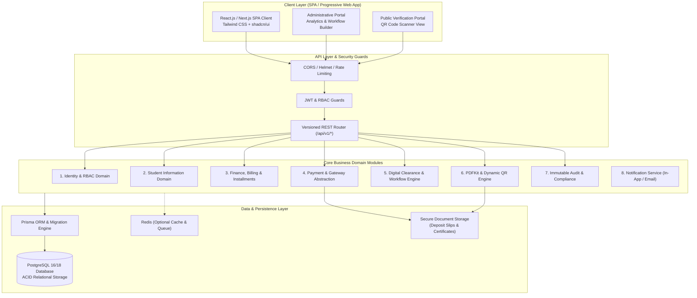

# Metropolitan University — Integrated Financial Management & Digital Clearance Portal
## Document: System Architecture & Technical Design
**Code:** `CPCS-MU-DOC-003`  
**Version:** 1.0.0  

---

### 1. Architectural Style: Modular Monolith

To avoid premature distributed systems complexity while ensuring maximum extensibility, the portal is architected as a **Modular Monolith**. 

Each business domain is encapsulated in its own module with strict interface boundaries:
- Modules do not query each other's private tables directly; they interact through documented service interfaces and domain events.
- If high scale or independent deployment is required in the future (e.g., separating the Payment Gateway or Clearance Workflow Engine), any module can be extracted into an independent microservice with minimal architectural refactoring.



---

### 2. Technology Stack Selection & Rationale

| Layer | Selected Technology | Architectural Justification |
|---|---|---|
| **Frontend Framework** | **React.js / Next.js (TypeScript)** | Single Page Application (SPA) architecture delivering responsive, low-latency status dashboards, student portals, and visual workflow builders. |
| **Styling & Components** | **Tailwind CSS & Lucide Icons** | Design system tokenization matching Metropolitan University branding with accessible contrast and zero CSS bloat. |
| **State & Forms** | **TanStack Query, React Hook Form, Zod** | Declarative server-state caching, automatic background revalidation, and runtime schema validation for complex financial forms. |
| **Backend Framework** | **Node.js with Express.js / NestJS (TypeScript)** | Enterprise RESTful architecture, lightweight event loops, thin controllers, modular domain services, and Swagger OpenAPI documentation. |
| **Database & ORM** | **PostgreSQL with Prisma ORM** | Strong schema integrity, native enums, type-safe transactions, relational audit logs, and predictable migrations. |
| **Utilities & Tooling** | **PDFKit & QRCode** | Native server-side vector graphics and cryptographic QR stamp rendering without external headless browser overhead. |
| **DevOps & Containers** | **Docker & Docker Compose** | Unified multi-container orchestration for PostgreSQL, Redis, API backend, and frontend web servers. |

---

### 3. Domain Module Breakdown

```
src/
├── modules/
│   ├── auth/              # JWT, password hashing, session guards, RBAC
│   ├── students/          # Student profile, programme, department, enrolment
│   ├── finance/           # Fee categories, billing, 4-installment scheduler, waivers
│   ├── payments/          # Payment gateway abstraction (bKash/Nagad), bank slip uploads
│   ├── clearance/         # Configurable workflow state machine, stage reviews
│   ├── certificates/      # PDFKit certificate rendering, QR stamping, public verification
│   ├── audit/             # Append-only activity logging, compliance trails
│   └── notifications/     # Event-driven in-app alerts and email dispatches
├── shared/
│   ├── config/            # Environment parsing & database connection
│   ├── middleware/        # Error handlers, rate limiters, validation pipes
│   └── utils/             # Crypto helpers, date formatters, file parsers
```

---

### 4. Event-Driven Internal Decoupling

Cross-module operations emit internal domain events rather than tight direct coupling:
1. `PaymentVerifiedEvent` $\rightarrow$ triggers `FinanceModule.allocateToInvoice()` $\rightarrow$ triggers `ClearanceModule.reEvaluateDues()`
2. `StageReviewApprovedEvent` $\rightarrow$ triggers `ClearanceModule.evaluatePipeline()` $\rightarrow$ if all stages are approved, triggers `CertificateModule.issueCertificate()`
3. `ApplicationFlaggedEvent` $\rightarrow$ triggers `NotificationModule.dispatchStudentAlert()`

