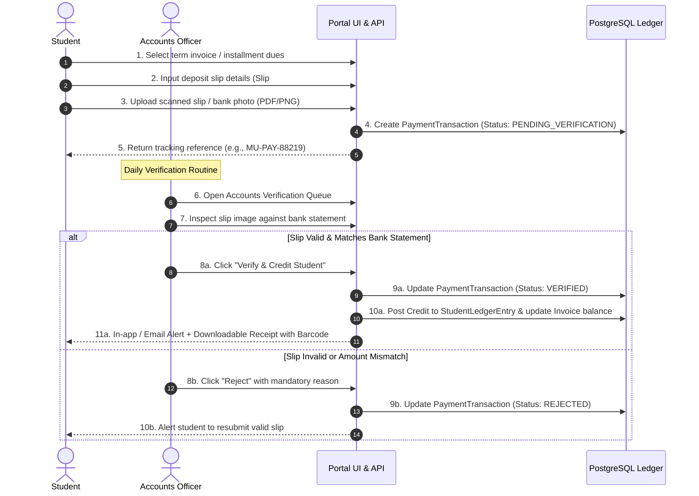
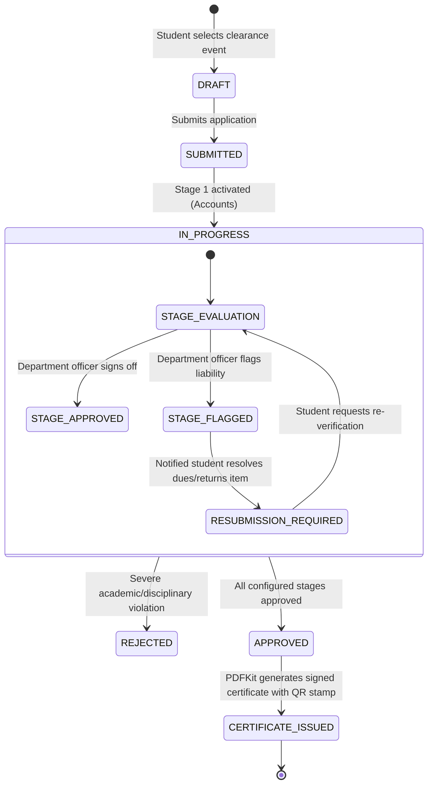

# Metropolitan University — Integrated Financial Management & Digital Clearance Portal
## Document: Workflow Design & Transaction State Machines
**Code:** `CPCS-MU-DOC-006`  
**Version:** 1.0.0  

---

### 1. Financial Payment Processing Workflows

#### Flow A: Manual Bank Deposit (NRBC Bank Campus Branch)
Metropolitan University students pay fees via direct deposit at NRBC Bank, Bateshwar Branch (Account: `015954000000001`):

---

### 2. Configurable Clearance Workflow Engine

The clearance pipeline is dynamic and configurable. Different clearance events follow tailored workflows:

#### Workflow Variant 1: Semester Final Examination Clearance
1. **Accounts Section** (Zero semester balance check)
2. **Central Library** (No overdue books)
3. **Department Head** (Course registration & lab attendance confirmation)
4. $\rightarrow$ **Admit Card & Clearance Slip Issued**

#### Workflow Variant 2: Final Graduation / Convocation / Certificate Clearance
1. **Accounts Section** (Settlement of all academic fees, convocation fee, and graduation charges)
2. **Central Library** (Return of all books and library card cancellation)
3. **Departmental Laboratories** (CSE/EEE lab kits, project hardware return)
4. **Hall Administration** (Female resident room clearance, damage inspection)
5. **Department Head** (Final year thesis/internship report submission)
6. **Controller of Examinations** (Credit audit, degree award eligibility check)
7. $\rightarrow$ **Digital Clearance Certificate Generated with Dynamic QR Code**

---

### 3. Issue Flagging & Resubmission Lifecycle

When an administrative unit identifies an outstanding liability:
1. The officer selects **Flag Issue** and inputs:
   - Specific reason (e.g. *"Overdue textbook 'Algorithm Design' (Acc # 4821) not returned"*).
   - Liability amount in BDT (if monetary fine applies).
2. The clearance application enters `FLAGGED` status for that department.
3. The student receives an immediate alert with resolution instructions:
   - If monetary: Student can click **Pay Fine Online** directly from the portal.
   - If material: Student returns the equipment/book to the department.
4. The student clicks **Submit for Re-verification**.
5. The officer is notified, verifies the returned item or settled fine, and updates the stage to `APPROVED`.
6. **Audit Continuity:** All prior flags, notes, and timestamps are preserved immutably in `clearance_issues` and `audit_logs`.

